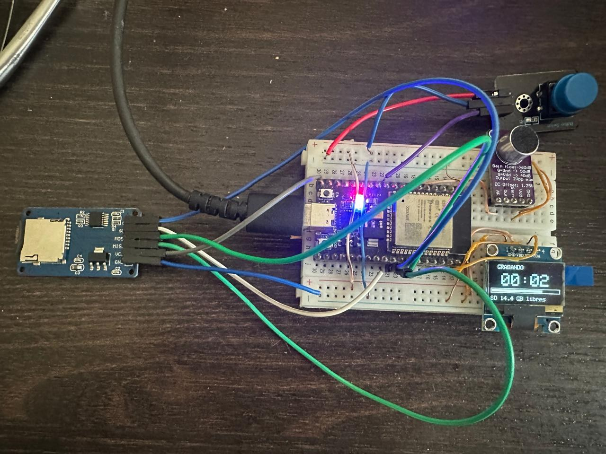
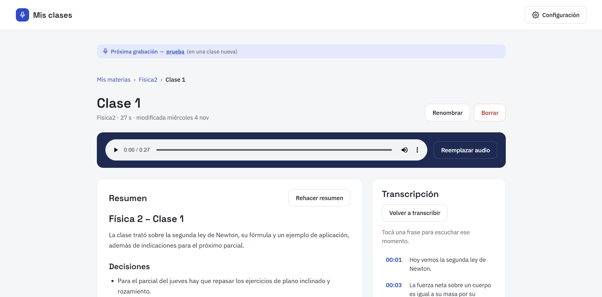
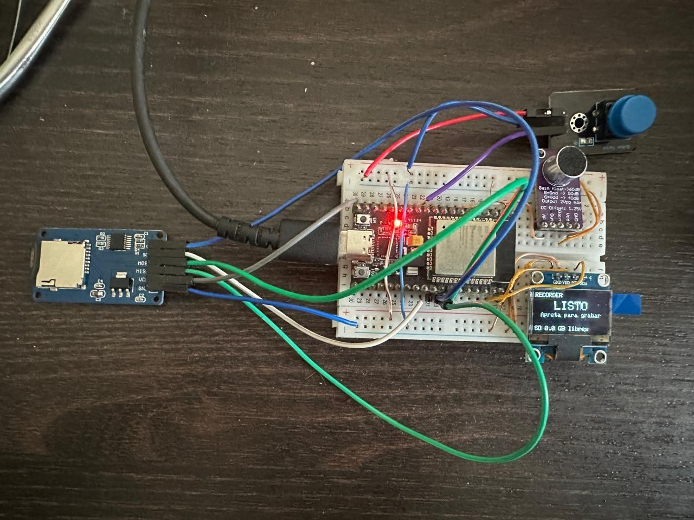
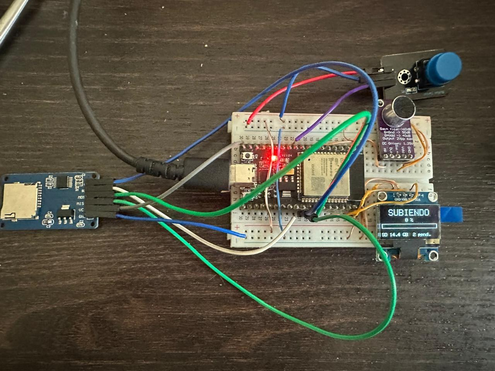
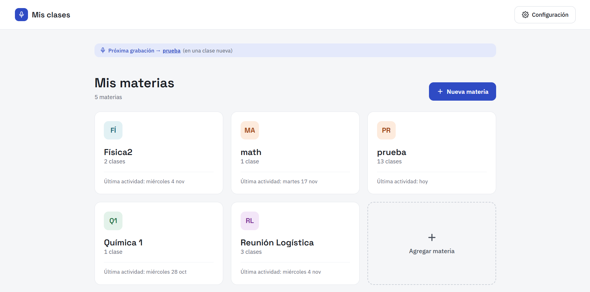
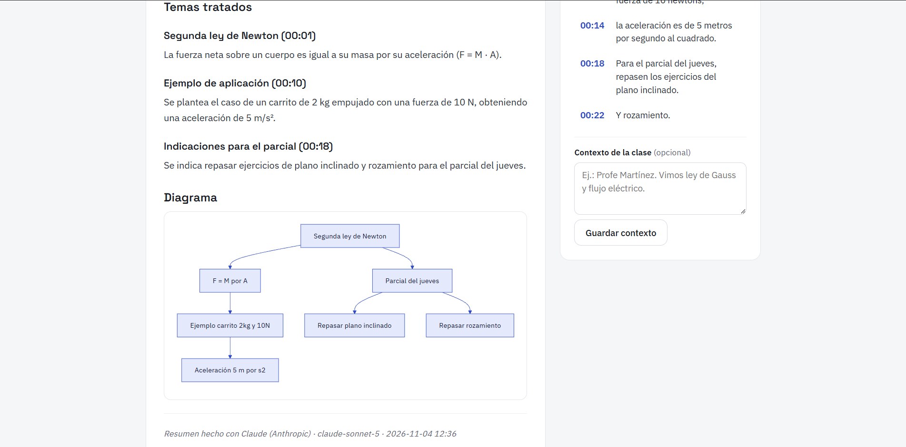
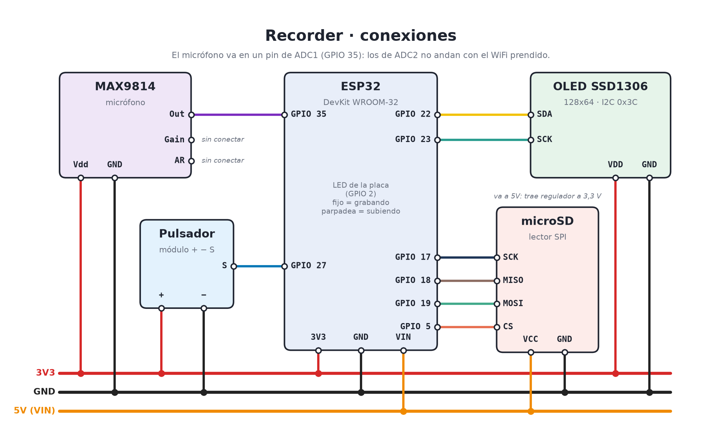
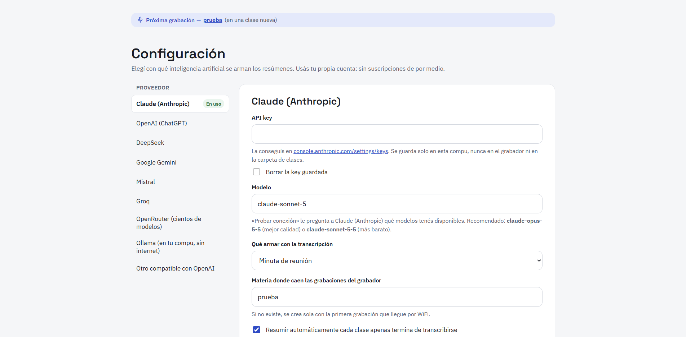

# 🎙️ Recorder

**Un grabador de clases y reuniones casero y open source.** Apretás el botón al empezar, lo apretás al terminar, y al rato tenés en la compu el audio, la transcripción y la minuta, ordenados por materia.

Sin suscripciones, sin cuentas y sin nube obligatoria: **vos elegís qué inteligencia artificial usar, y tus clases son archivos comunes en tu compu.**

<p align="center">
  
  
</p>

---

## Cómo funciona

```
 🎓 En clase                 🏠 En casa                          📚 Para estudiar
┌───────────────┐  WiFi    ┌──────────────────────────────┐    ┌──────────────────┐
│ ESP32 graba   │ ───────► │ Whisper transcribe (local)   │ ─► │ Audio            │
│ a la microSD  │          │ La IA que elijas resume      │    │ Transcripción    │
└───────────────┘          └──────────────────────────────┘    │ Minuta           │
                                                               └──────────────────┘
```

1. **Grabás.** Un apretón empieza, otro termina. El audio va directo a la microSD, sin WiFi mientras graba.
2. **Se sube solo.** Al terminar, el grabador se conecta al WiFi de casa y manda la grabación a la web que corre en tu compu. Si se corta, retoma donde quedó.
3. **Se transcribe en tu compu** con Whisper: gratis y privado.
4. **Se resume con la IA que quieras:** Claude, ChatGPT, Gemini, DeepSeek, Mistral, Groq, OpenRouter, o un modelo local con Ollama.

La pantalla del grabador te va contando qué pasa: grabando, subiendo, "Transcribiendo 40%", "Minuta lista!".

<p align="center">
  
  
  
</p>

## Qué tiene la web

- 📁 Materias y clases, como carpetas: `Facultad/Física 1/Clase 3/`
- 🎙 En una clase tocás **"Que la próxima grabación caiga acá"** y la grabación llega directo a esa carpeta
- 🎧 Reproductor: tocás una frase de la transcripción y el audio salta ahí
- ✍️ Minutas con títulos por tema, el minuto de cada uno, fórmulas y diagramas (Mermaid)
- 🔌 Cualquier proveedor de IA, con tu propia API key
- 🗂️ Todo en Markdown: también se abre con Obsidian, y si la web se rompe no perdés nada

<p align="center">
  
  
</p>

---

## 🧩 Componentes

| Componente | Para qué sirve | Cantidad |
|---|---|---|
| ESP32 DevKit (WROOM-32) | El cerebro: graba, guarda y sube por WiFi | 1 |
| Micrófono MAX9814 | Capta la voz (tiene ganancia automática) | 1 |
| Pantalla OLED SSD1306 128x64 I2C | Muestra el estado, el tiempo grabado y el espacio libre | 1 |
| Lector de microSD SPI + tarjeta microSD | Guarda las grabaciones (FAT32) | 1 |
| Módulo pulsador de 3 pines (+, −, S) | Empezar / terminar de grabar | 1 |
| Protoboard y cables dupont | Para armarlo sin soldar | 1 + varios |

> El firmware lee el botón como "HIGH al apretar", así que también anda un sensor táctil TTP223 conectado igual.

## 🔌 Conexiones

<p align="center"></p>

| Módulo | Pin (como dice la placa) | Va a la ESP32 |
|---|---|---|
| 🎤 Micrófono MAX9814 | Out | GPIO 35 |
| 🎤 Micrófono MAX9814 | Vdd | 3V3 |
| 🎤 Micrófono MAX9814 | GND | GND |
| 🎤 Micrófono MAX9814 | Gain, AR | sin conectar |
| 🖥️ OLED SSD1306 | SDA | GPIO 22 |
| 🖥️ OLED SSD1306 | SCK (es el SCL del I2C) | GPIO 23 |
| 🖥️ OLED SSD1306 | VDD | 3V3 |
| 🖥️ OLED SSD1306 | GND | GND |
| 🔘 Pulsador | S | GPIO 27 |
| 🔘 Pulsador | + | 3V3 |
| 🔘 Pulsador | − | GND |
| 💾 Lector microSD | SCK | GPIO 17 |
| 💾 Lector microSD | MISO | GPIO 18 |
| 💾 Lector microSD | MOSI | GPIO 19 |
| 💾 Lector microSD | CS | GPIO 5 |
| 💾 Lector microSD | VCC | 5V (VIN) |
| 💾 Lector microSD | GND | GND |

Detalles que importan:

- 🎤 **El micrófono tiene que ir en GPIO 35** (o cualquier pin de ADC1). Los pines de ADC2 no funcionan con el WiFi prendido.
- 💾 **La microSD va a 5V**: la mayoría de los lectores traen su propio regulador a 3,3 V.
- 💡 El LED azul de la placa (GPIO 2) queda fijo mientras graba y parpadea mientras sube.

---

## ⚡ Cargar el firmware

1. Instalá el [Arduino IDE](https://www.arduino.cc/en/software).
2. **Instalá la placa ESP32:** en *Archivo → Preferencias → URLs adicionales de gestor de placas* pegá
   `https://espressif.github.io/arduino-esp32/package_esp32_index.json`.
   Después, en *Herramientas → Placa → Gestor de placas*, buscá **esp32** (de Espressif Systems) e instalalo (probado con la 3.3.11).
3. **Instalá las librerías** desde *Herramientas → Administrar bibliotecas*:
   - **Adafruit SSD1306**
   - **Adafruit GFX Library**
   - **Adafruit BusIO** (el IDE la ofrece sola como dependencia)

   El resto (WiFi, SD, SPI, Wire, HTTPClient, Preferences) viene con la placa.
4. Abrí **`firmware/grabador/grabador.ino`**.
5. Elegí la placa **ESP32 Dev Module** y el puerto, y apretá **Subir**. Cerrá el monitor serie antes de subir.

### El WiFi va en la microSD

Formateá la microSD en **FAT32** y creá en la raíz un archivo `wifi.txt` (hay un ejemplo en [`firmware/grabador/wifi.txt.ejemplo`](firmware/grabador/wifi.txt.ejemplo)):

```
red=NombreDeTuRed
clave=LaClaveDelWiFi
compu=192.168.1.4:5000
```

`compu` es la IP de la compu donde corre la web (en Windows la ves con `ipconfig`, en Linux con `ip addr`). El ESP32 solo se conecta a redes de **2,4 GHz**.

Esa es la única credencial que guarda el grabador: las API keys quedan en tu compu.

<details>
<summary>Otros firmwares de la carpeta</summary>

| Carpeta | Para qué |
|---|---|
| `firmware/grabador/` | **El de uso**: graba a la microSD con el botón y sube por WiFi |
| `firmware/prueba_hardware/` | Prueba la OLED, la microSD y el botón (resultado por serie a 115200) |
| `firmware/diagnostico/` | Diagnóstico completo de la placa ESP32 |
| `firmware/microfono/` | Manda el audio por cable; lo usa `grabar_wav.py` para probar el micrófono |

</details>

---

## 💻 Correr la web

Necesitás **Python 3.11 o más nuevo** (probado con 3.13).

**Windows** (PowerShell):

```powershell
python -m venv venv
venv\Scripts\pip install -r requirements.txt
venv\Scripts\python web\app.py
```

**Linux / macOS:**

```bash
python3 -m venv venv
venv/bin/pip install -r requirements.txt
venv/bin/python web/app.py
```

Abrí **http://127.0.0.1:5000** en el navegador. La web escucha en toda la red local para que el grabador le pueda llegar por WiFi.

- La primera transcripción tarda más: Whisper baja el modelo `large-v3-turbo` (una sola vez).
- Las clases se guardan en `Facultad/` dentro de tu carpeta de usuario. Para usar otra carpeta, definí la variable `CLASES_DIR`.
- **En Windows**, la primera vez el firewall pregunta si Python puede usar la red: aceptá en **redes privadas**, si no el grabador no llega.
- También podés subir un audio a mano desde la web, sin grabador.

## 🤖 Configurar la IA

1. En la web, entrá a **Configuración**.
2. Elegí el proveedor (Claude, OpenAI, Gemini, DeepSeek, Mistral, Groq, OpenRouter, Ollama…).
3. **Pegá tu API key** en el campo *API key*. Al lado de cada proveedor hay un link a dónde sacarla.
4. Apretá **Probar conexión** para ver los modelos disponibles, elegí uno y **Guardar**.

<p align="center"></p>

La key se guarda solo en tu compu, en `~/.config/mis-clases/config.json` (en Windows, `%USERPROFILE%\.config\mis-clases\config.json`). Nunca va al grabador ni a la carpeta de clases.

🦙 **Con Ollama no hace falta API key**: todo corre en tu compu, sin internet. Instalá [Ollama](https://ollama.com), bajá un modelo (`ollama pull ...`) y elegí "Ollama" en Configuración.

---

## 📂 El proyecto

| Carpeta | Qué hay |
|---|---|
| `web/` | La aplicación: Flask + Whisper + proveedores de IA |
| `firmware/` | Lo que corre en la ESP32 (Arduino) |
| `audio.py`, `grabar_wav.py` | Formato del audio del ADC y diagnóstico del micrófono por cable |
| `docs/PLAN.md` | Cómo se fue armando y qué falta |

## 🚦 Estado

- 🟢 **Grabar:** con el pulsador, directo a la microSD
- 🟢 **Pantalla:** estado, tiempo, espacio libre y qué está haciendo la compu
- 🟢 **Subida automática por WiFi:** sola al terminar, y retoma si se corta
- 🟢 **Web:** materias, transcripción local con Whisper y minuta con la IA que elijas
- 🟡 **Formato:** por ahora en protoboard y siempre enchufado
- ⚪ **Pendiente:** batería, placa (PCB) y carcasa, y mejorar la calidad del audio (muestreo por DMA)

## 📄 Licencia

[MIT](LICENSE) © 2026 Tomás Zapani. Usalo, copialo, modificalo y armate el tuyo.

Hecho para la facultad, en una protoboard. 🛠️
